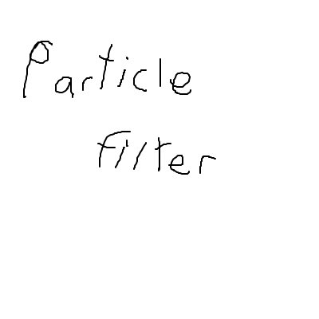

# Particle Filter



A client-side NeoForge mod for finding out which particles are cluttering your screen and hiding exactly those: everywhere, only inside zones you define, or only for specific blocks' breaking and mining effects.

Built for big modded bases where automation (AE2 growth accelerators, crystal farms, machines) fills the screen with particles, and turning particles down to "Minimal" would remove them everywhere else too.

> [!IMPORTANT]
> **AI disclosure: this mod's code was written by an AI.** All of the source code, build configuration and documentation were written by Claude, an AI model made by Anthropic, working in Claude Code. The project owner, Minihercules317, contributed the idea, the feature requests and the design decisions, tested it in game, and drew the icon. Minihercules317 did not write the code. See [Who did what](#who-did-what) for details.

## Features

- **Scan:** look at a machine and press Scan. For 5 seconds the mod records every particle spawned within 6 blocks, then lists them by particle ID (e.g. `ae2:energy_fx`) with how many appeared. Particles that mods spawn without a type are listed by class name.
- **Hide everywhere** or **hide here** with a checkbox per particle. "Hide here" adds it to the zone around the scanned spot, creating a 9×5×9 zone if there isn't one (previewed in the world before you commit).
- **Zones** are boxes with a name, a position (center X/Z, bottom Y) and a size (width × height × length, 1-256 blocks). Edit them by typing or with −/+, or snap them to your position or crosshair; the outline updates live in the world. Zones belong to one server (or singleplayer world) and dimension.
- **Block particles:** hide the breaking, mining and block-dust (sprinting/landing) particles of specific blocks, whole mods (`geore:*`), or block tags (`#c:ores`). A keybind toggles the block you're looking at.
- **One list of everything hidden**, showing whether each entry is hidden everywhere, in which zone, or for block breaking, with one-click unhide.
- Filtering happens at the particle engine, so it works however a mod spawns its particles, and hidden particles are never created (a small CPU saving rather than drawing them invisibly).

## Usage

Open the menu with **`/particles`**, the **Open Particle Filter** keybind, or the Config button in the Mods list. It has three tabs:

- **Scan:** look at the machine making the particles, press **Scan**, and tick **Hide everywhere** or **Hide here** next to each particle you want gone. The game keeps running while the menu is open, so the scan collects while you wait.
- **Hidden:** everything hidden and where. Unhide anything, or type an ID to hide it directly.
- **Zones:** zones in your current world. Hover a zone to highlight it, **Edit** to change its name, position, size and contents, or create a new one around you.

Commands (client-side only; nothing is sent to the server):

| Command | Does |
|---|---|
| `/particles` | Opens the menu on the last tab used |
| `/particles scan` | Starts a scan at your crosshair and opens the Scan tab |
| `/particles hidden` | Opens the Hidden tab |
| `/particles zones` | Opens the Zones tab |

Keybinds (unbound by default, under Controls → Particle Filter): Open Particle Filter, Scan Particles at Crosshair, Hide/Show Breaking Particles of Targeted Block, Always Show Zone Outlines.

Settings are stored in `config/particlefilter.json`.

## Compatibility

- Minecraft 1.21.1, NeoForge 21.1+. Client-side only: install it on your client; servers don't need it.
- Works alongside particle optimization mods such as Particle Core and Sodium.

## Limitations

- Zones are tied to the server address you connect with; connecting through a different address won't show them.
- Effects that mods draw with their own renderers, rather than the particle system, can't be filtered.
- Tested so far on one large modpack (All the Mods 10: To the Sky) and in a minimal development setup. Expect rough edges with other mods; bug reports are welcome.

## Who did what

**Minihercules317 (project owner): idea, design decisions, testing. No code.**

- Found the problem (breaking particles from GeOre ores and particle spam from AE2 growth accelerators in a large modpack) and asked for a way to hide specific particles rather than all of them.
- Asked for or decided on each feature: a menu reached by clicking the scan results, hiding particles only inside an area, seeing those areas in the world, outlines that update live while resizing, typing sizes instead of picking presets, naming and moving zones, one list showing everything hidden and where, one command for everything, and zones measured by width, height and length instead of a radius.
- Decided to turn the work into a standalone mod instead of a fork, named it, asked for a cleaner and more intuitive GUI, and chose to publish it.
- Tested every version in game and reported problems, with screenshots.
- Drew the mod icon.

**Claude (Anthropic's AI model, via Claude Code): all of the code and documentation.**

- Looked for existing mods that already solved this, then built the first prototype as additions to a fork of Particle Core.
- Designed the standalone architecture and wrote all of the Java source, mixins, GUI layout, build configuration, README and changelog.
- Tested it with an automated in-game self-test (spawning particles, scanning, hiding, and screenshotting each screen), then fixed the issues it and Minihercules317 found.

The code was tested in game, but no human has reviewed it line by line.

## Relationship to Particle Core

The features were first prototyped inside a fork of [Particle Core](https://github.com/fzzyhmstrs/pc) by fzzyhmstrs (MIT License), extending its per-type particle settings. Particle Filter then replaced that fork with a ground-up rewrite. **It contains no code from Particle Core**, does not depend on it, and runs fine next to the official Particle Core.

## Building

Requires JDK 21.

```sh
./gradlew build
```

The jar is written to `build/libs/`. `./gradlew runClient` starts a development client.

## License

MIT. See [LICENSE](LICENSE). The Gradle wrapper files (`gradlew`, `gradle/wrapper/`) are from the Gradle project and are licensed under the Apache License 2.0.
