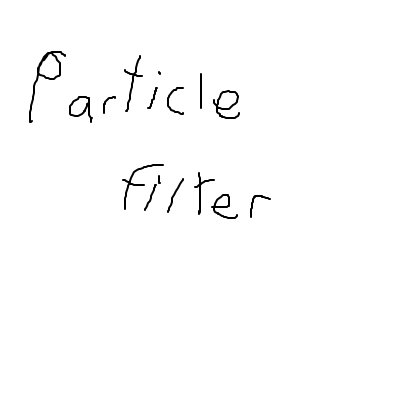
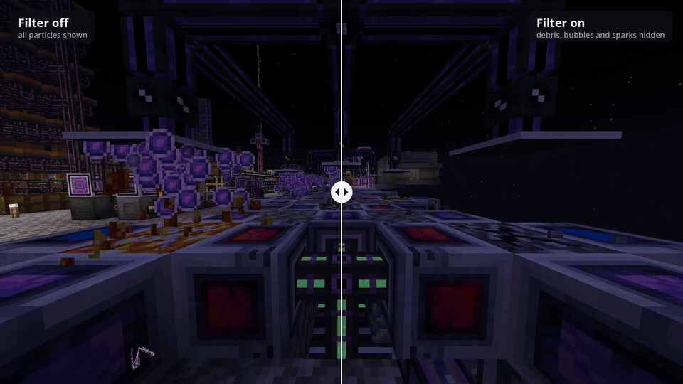
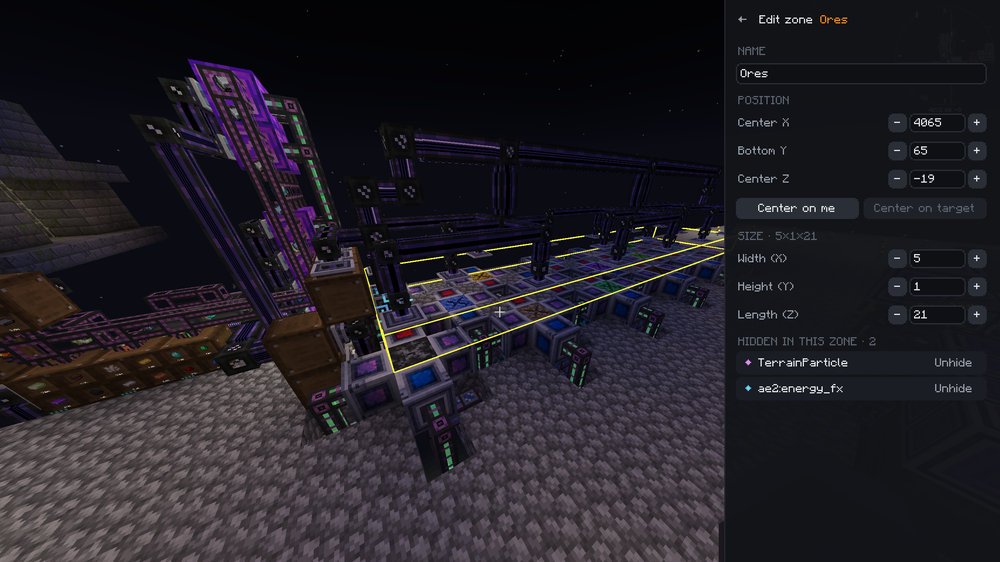
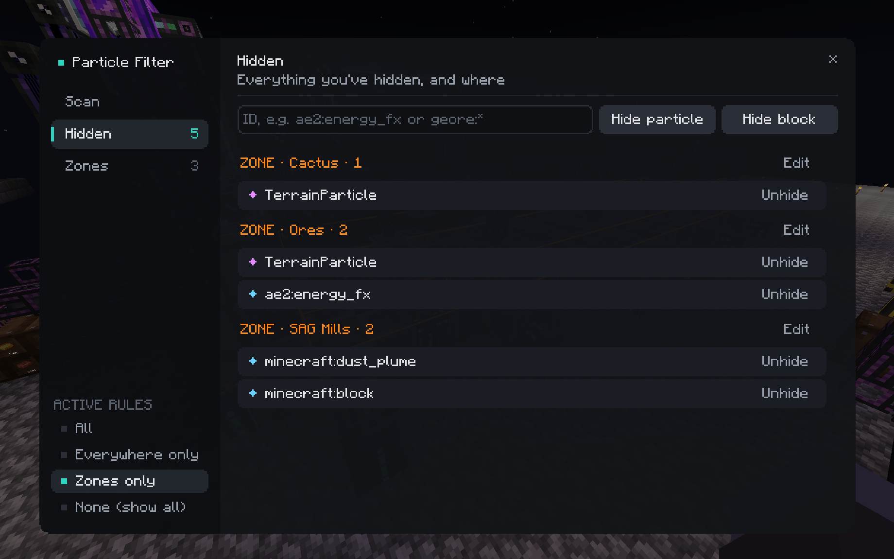
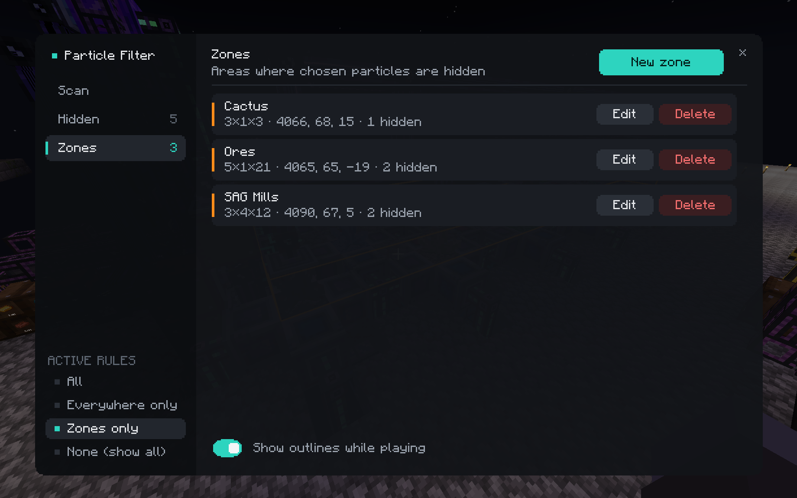
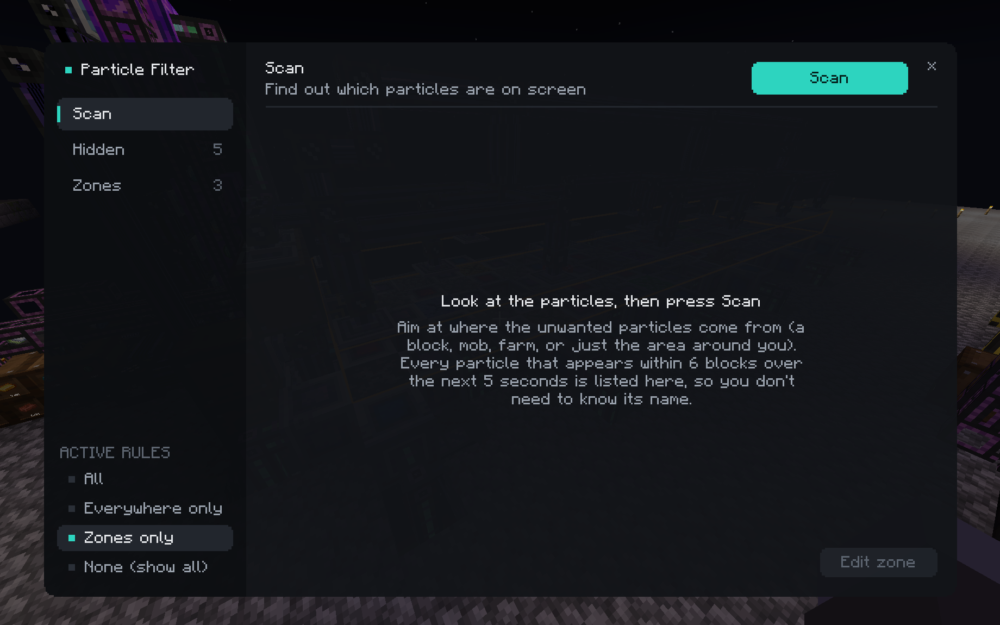
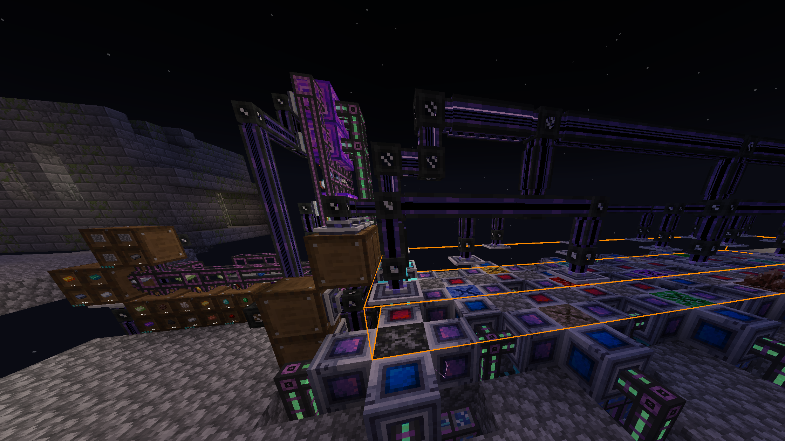

# Particle Filter



A client-side Minecraft mod (NeoForge 1.21.1 and Forge 1.20.1) for hiding exactly the particles you don't want: everywhere, only inside areas you choose, or only for specific blocks' breaking and mining effects. Everything else keeps its particles.

The usual fix for too many particles is setting Particles to *Minimal*, which removes almost all of them everywhere. Particle Filter is for when you only want *some* gone. Use it to:

- calm down busy bases, farms and automated setups
- stop particular blocks from bursting into debris when you break or mine them
- remove one annoying particle from a mod without uninstalling the mod
- win back FPS when particles pile up (hidden particles are never created, not just drawn invisibly)
- clean up the view for screenshots, recording or streaming
- cut visual noise if certain effects are distracting or uncomfortable to look at

You don't need to know what a particle is called: a built-in scan finds it for you. It works with vanilla and modded particles.

**Download:** [CurseForge](https://www.curseforge.com/minecraft/mc-mods/particle-filter) (installs with one click in the CurseForge app) or [GitHub Releases](https://github.com/Minihercules317/particle-filter/releases).

> [!IMPORTANT]
> **AI disclosure: this mod's code was written by an AI.** All of the source code, build configuration and documentation were written by Claude, an AI model made by Anthropic, working in Claude Code. The project owner, Minihercules317, contributed the idea, the feature requests and the design decisions, tested it in game, and drew the icon. Minihercules317 did not write the code. See [Who did what](#who-did-what) for details.

## Screenshots

[](https://minihercules317.github.io/particle-filter/compare/)

A crystal farm in All the Mods 10: To the Sky with all particles shown (left) and with its debris, bubbles and sparks hidden (right). Same spot, same moment in the farm's cycle; the blocks are untouched. **[Try the interactive comparison](https://minihercules317.github.io/particle-filter/compare/)**.



| | |
|---|---|
|  |  |
| **Hidden:** everything hidden, grouped by where it applies | **Zones:** each zone's size, position and hidden count |
|  |  |
| **Scan:** lists every particle near what you're looking at, with counts | **Zone outlines** can stay visible while you play |

Screenshots are from All the Mods 10: To the Sky.

## Features

- **Scan:** look at where the particles are coming from (or just stand near them) and press Scan. For a few seconds (3 by default, adjustable from 1 to 60) the mod records every particle spawned within a radius you set (6 blocks by default, up to 32), then lists them by particle ID (e.g. `minecraft:flame`, `ae2:energy_fx`) with how many appeared. Particles that mods spawn without a type are listed by class name. Particles made from a block, like breaking and mining debris or the dust when you land on a block, are listed once per block (e.g. `TerrainParticle (minecraft:stone)`), so you can hide one block's and keep another's. Particles your rules already hide are listed too, dimmed and after those still appearing, so you can see what's left once your rules are in place and show any of them again.
- **Folders:** results are grouped by mod, so a modpack's worth of particles stays readable. Each mod's folder holds its particles and, in a "Made from … blocks" folder, everything made from its blocks; a particle made from many blocks (like `minecraft:block` debris) gets its own folder, split by the blocks' mod. A folder's switch hides the whole group with one rule that also covers particles the scan didn't catch: all GeOre particles and everything made from GeOre blocks, every debris particle, or just debris from GeOre's blocks. A folder's switch shows partly on when only some of its particles are hidden. Click a folder to open or close it.
- **Hide everywhere** or **hide here** with a switch per particle or folder. "Here" adds it to the zone around the scanned spot. If there isn't one, it makes zones fitted to where the particles appeared, one per source, and no bigger: spots close together count as one source, so two machines far apart get separate zones. A particle with more sources than Here makes zones for (8 by default) gets a suggestion to hide it everywhere instead. Hover a row to see its zones outlined. The line under the results says where Here hides particles, and a button switches between an existing zone and new zones. If a zone hides a particle that still appears just outside it, **Grow to fit** offers to enlarge that zone to cover them (it never shrinks); hover the notice to see the new outline first.
- **Zone options** (closed by default, under the scan length and radius) fine-tune the zones Here makes: how far apart spots can be and still count as one source (6 blocks by default), how many zones one particle gets (8), and how much zones must overlap to merge into one box around both (50% of the smaller zone; at 0% zones that touch face to face merge too, and zones follow the slider as you drag it). While open, the number beside each Here switch says how many zones it makes.
- **Zones** are boxes with a name, a position (center X/Z, bottom Y) and a size (Side 1 × height × Side 2, 1-256 blocks each, with the number of blocks affected). The editor labels each side with the way it runs from where you're facing (left–right or front–back). Edit them by typing or with −/+, or snap them to your position or crosshair; the outline updates live in the world. Each zone gets its own outline color, and touching or overlapping zones never share one. Zones belong to one server (or singleplayer world) and dimension.
- **Groups by hand:** the Hidden page takes a particle ID, a mod's particles (`geore:*`), or a particle from certain blocks (`minecraft:block@geore:*`, `minecraft:block@#c:ores`). **Hide block** hides everything made from a block, a mod's blocks (`geore:*`) or a block tag (`#c:ores`): breaking, mining and block-dust (sprinting/landing) particles. A keybind toggles the block you're looking at. Hiding a group removes the narrower entries it covers.
- **One list of everything hidden**, showing whether each entry is hidden everywhere or in which zone (with its coordinates), with groups by name ("Everything made from GeOre blocks"). Switch an entry off to see the particle again without losing it, or delete it.
- **Active rules:** switch between applying all your rules, only the everywhere ones, only zones, or none, from the menu or a keybind. Handy for comparing before and after; your rules are kept either way. There's also a **Hold to Show All Particles** keybind that pauses every rule only while held.
- Filtering happens at the particle engine, so it works however a mod spawns its particles, and hidden particles are never created (a small CPU saving rather than drawing them invisibly).

## Usage

Open the menu with **`/particles`** or the **Open Particle Filter** keybind. It reopens on the page you last used until you leave the world or server. Drag its background to move it and its right or bottom edge to resize it; it reopens where you left it, and a double-click on the background puts it back. The **?** button at the top opens a short quick start guide. The sidebar has three pages and the Active rules switch:

- **Scan:** look at where the unwanted particles are coming from, press **Scan**, and switch on **Everywhere** or **Here** next to each particle or folder you want gone. The game keeps running while the menu is open, so the scan collects while you wait.
- **Hidden:** everything hidden and where. Switch entries off and on, delete them (or a whole zone), or type an ID or group to hide it directly (Enter hides it as a particle; the text turns red if it isn't valid).
- **Zones:** zones in your current world. Hover a zone to highlight it, **Edit** to change its name, position, size and contents in a side panel (the world stays visible so you can watch the outline move), or create a new one around you.
- **Active rules:** **All**, **Everywhere only**, **Zones only**, or **None (show all)**. Entries that are switched off show as *Paused* on the Hidden page.

Commands (client-side only; nothing is sent to the server):

| Command | Does |
|---|---|
| `/particles` | Opens the menu on the last page used in this world or server |
| `/particles scan` | Starts a scan at your crosshair and opens the Scan page |
| `/particles hidden` | Opens the Hidden page |
| `/particles zones` | Opens the Zones page |

Keybinds (unbound by default, under Controls → Particle Filter): Open Particle Filter, Scan Particles at Crosshair, Hide/Show Breaking Particles of Targeted Block, Always Show Zone Outlines, Cycle Active Rules, Hold to Show All Particles.

The **Config** button in the Mods list opens two more settings (both off by default) and, in a world, a button to the menu:

- **Walk while the menu is open:** move, jump and sneak with your usual keys while a Particle Filter screen is open, except while typing in a box. To sprint, close the menu.
- **Lines to zones:** a line from your crosshair to the center of each zone, in the zone's outline color, whenever outlines show. The lines show through blocks.

Settings are stored in `config/particlefilter.json`.

## Compatibility

- Minecraft 1.21.1 with NeoForge 21.1+, or Minecraft 1.20.1 with Forge 47+. Download the jar for your version and loader. Client-side only: install it on your client; servers don't need it.
- Works alongside particle optimization mods such as Particle Core and Sodium (tested on 1.21.1).

## Limitations

- Zones are tied to the server address you connect with; connecting through a different address won't show them.
- Effects that mods draw with their own renderers, rather than the particle system, can't be filtered.
- Tested so far on one large modpack (All the Mods 10: To the Sky) and in a minimal development setup. Expect rough edges with other mods; bug reports are welcome.

## Who did what

**Minihercules317 (project owner): idea, design decisions, testing. No code.**

- Found the problem in their own modpack (breaking particles from GeOre ores and particle spam from AE2 growth accelerators) and asked for a way to hide specific particles rather than all of them.
- Asked for or decided on each feature: a menu reached by clicking the scan results, hiding particles only inside an area, seeing those areas in the world, outlines that update live while resizing, typing sizes instead of picking presets, naming and moving zones, one list showing everything hidden and where, one command for everything, zones measured by width, height and length instead of a radius, a way to cycle between which rules apply, and a modern menu redesign. For 1.3.0: zones sized to fit the scanned particles, an adjustable scan duration and radius, making a new zone from a scan inside an existing one, separating particles still appearing from hidden ones and giving each source of a particle its own fitted zone (first as a separate Diagnostic page, then merged into Scan with its settings in an optional section, so new players get a simple page and experienced ones can fine-tune), grouping scan results like folders so a whole mod's or block's particles can be hidden at once, an adjustable source distance and a slider for how much zones must overlap to merge (following the slider live, down to 0% for zones that touch), showing how many zones Here will make, a way to keep some blocks' terrain particles while hiding others, Grow to fit for zones that miss nearby particles, switching hidden entries off instead of only deleting them, zone coordinates on the Hidden page, Side 1 and Side 2 with direction labels and a block count, distinct colors for overlapping zones, reopening the last menu during a session, clearer Back buttons, a quick start guide, slimmer switches, a menu window that can be moved and resized, walking while the menu is open (after asking Claude to check that this is fine on servers), lines from the crosshair to zones, and keeping those last two in the Mods list's Config screen so the menu stays uncluttered.
- Decided to turn the work into a standalone mod instead of a fork, named it, asked for a cleaner and more intuitive GUI, and chose to publish it.
- Tested every version in game and reported problems, with screenshots.
- Drew the mod icon.

**Claude (Anthropic's AI model, via Claude Code): all of the code and documentation.**

- Looked for existing mods that already solved this, then built the first prototype as additions to a fork of Particle Core.
- Designed the standalone architecture and wrote all of the Java source, mixins, GUI layout, build configuration, README and changelog.
- Tested it with an automated in-game self-test (spawning particles, scanning, hiding, and screenshotting each screen), then fixed the issues it and Minihercules317 found.

The code was tested in game, but no human has reviewed it line by line.

## Relationship to Particle Core

The features were first prototyped inside a fork of [Particle Core](https://github.com/fzzyhmstrs/pc) by fzzyhmstrs (MIT License), extending its per-type particle settings. Particle Filter then replaced that fork with a ground-up rewrite. **It contains no code from Particle Core**, does not depend on it, and runs fine next to the official Particle Core.

## Building

Requires JDK 21; Gradle downloads JDK 17 for the Forge 1.20.1 build itself. The build uses [Stonecutter](https://stonecutter.kikugie.dev/) to make a jar for each Minecraft version and loader from the same source.

```sh
./gradlew build buildAndCollect
```

The jars are written to `build/libs/<version>/`. `./gradlew :1.21.1-neoforge:runClient` (or `:1.20.1-forge:runClient`) starts a development client.

## License

MIT. See [LICENSE](LICENSE). The Gradle wrapper files (`gradlew`, `gradle/wrapper/`) are from the Gradle project and are licensed under the Apache License 2.0.
